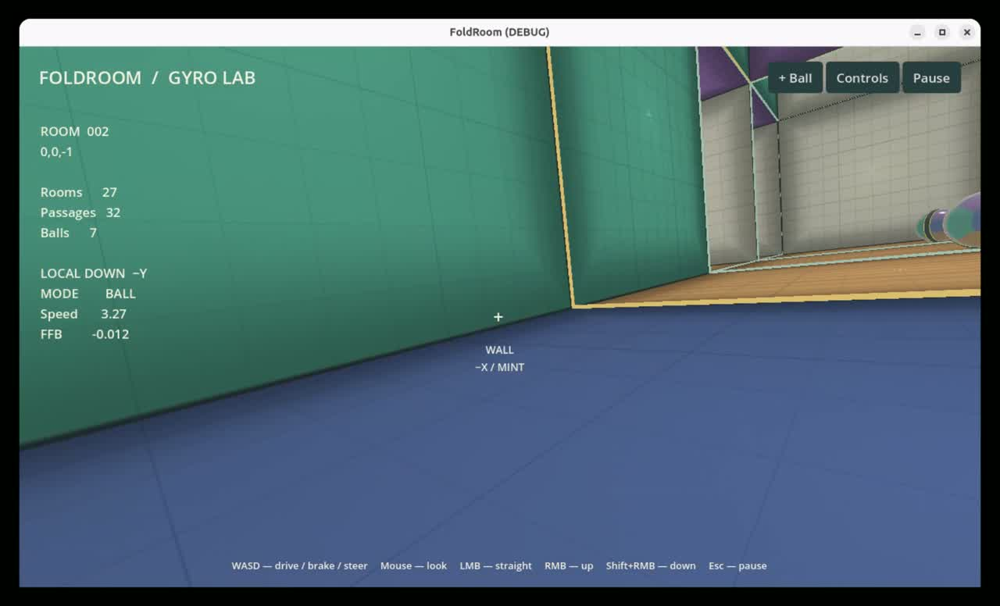
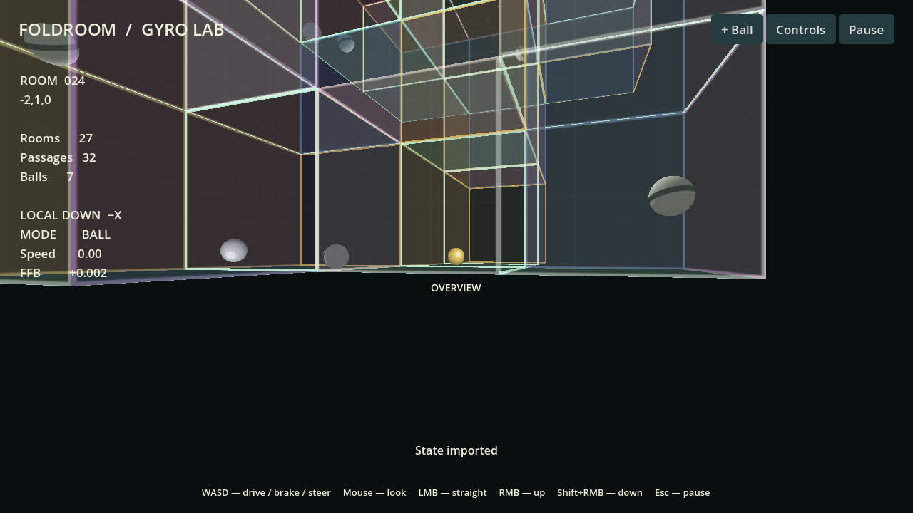

# FoldRoom

Godot port of my game originally created in GPT Sites, with Moza force feedback.

## Preview





[Watch the tube demo and gameplay clips](https://lajasoft.github.io/foldroom/) · [Wheel and controls](docs/media/controls.jpg)

## CI and Linux builds

```bash
bash docker/run-ci.sh
```

GitHub Actions and GitLab CI run the same Docker pipeline: native regressions, original web tests, JSON round-trip verification, Linux release export and a headless launch of the exported executable. Results and logs are copied to `artifacts/`, including a tarball and SHA-256 checksum. The CI container needs no GPU or wheel. Desktop services continue to use the runtime image.

See [CI setup and test cases](docs/ci.md) and [Flatpak packaging assessment](docs/flatpak.md).

## Run

```bash
# Native game, NVIDIA + X11 + Moza + PulseAudio
docker compose up godot

# Godot editor
docker compose run --rm godot-editor

# Original browser game at http://localhost:8080
docker compose up site
```

The native launcher imports the project and registers the FFB extension before running, including on a fresh checkout. No Node/npm, PHP or Godot installation on the host is needed.

The game opens paused. Enter starts; Escape pauses. Ball mode starts stationary; W accelerates and S brakes. A/D turn toward the side of the rendered screen. Shift boosts ×5. Mouse steers horizontally and adjusts pitch vertically. M switches between Ball and Walk. Arrow keys are secondary movement bindings.

LMB creates a straight passage; RMB folds upward; Shift+RMB folds downward. Delete removes both ends and discards rooms outside the player’s connected component, including balls in those rooms. Remaining room IDs are compacted; if the original start is discarded, the first retained room becomes the new origin. Folded entry walls cannot have a solid backside in an adjacent room: carving, closing a passage, and adding rooms all enforce this rule. Existing imports remain compatible; edits cannot introduce new violations. Shift+LMB draws on a wall. B spawns a powered sphere; Shift+B removes the oldest (16 maximum). Scroll pulls the camera back through the lattice into a transparent external overview. Home returns to the start. Ctrl+R resets the maze.

Pause → **Controls / Wheel / Audio** assigns keys, mouse buttons, gamepad buttons and Linux wheel buttons. Each action has Primary and Secondary assignments: keep the mouse/keyboard control and assign a wheel button alongside it. Click either slot and press the intended input; Escape cancels assignment, and × clears only that slot. Old single-assignment settings load into Primary. Holding both inputs keeps the action active until both are released, without double-triggering an identical binding. Axis assignment learns the ABS code from an axis moved through at least 20% of its travel. The screen shows live steering/pedal values, offers per-axis inversion, physical wheel range, game steering lock, deadzone, FFB enable/direction/strength and effects volume. Settings persist under `.runtime/godot/`, together with quick saves.

Pause → **Rooms ↔ Tubes** switches geometry inside the existing 6-unit cells. Tubes have radius **1.65** and spheres radius **0.33**; room mode retains radius 0.5 spheres. Switching and loading old tube saves scale each sphere's offset from the nearest pipe axis or bend centerline, preserving progress toward the portal. Linear velocity, drive acceleration and gravity scale by 0.66; angular speed is retained. New saves keep the smaller radius and are not scaled twice. The original quick save file is only changed by an explicit save.

The six local opening bits select one of ten fitting families (including an isolated room): end cap, straight, elbow, planar T, trihedral, planar cross, spatial four-way, five-way and six-way. Every opening has the same circular collar. Portal kind, target and rotation do not influence fitting shape. The existing ray tracer still handles transport; its surface query now makes two bilinear reads from a prepared field atlas. Physics interpolates the same field. No adjacent-room surface evaluation or runtime boolean geometry remains. The exterior overview continues to show the room lattice.

See [fitting catalogue, generation and validation](docs/pipe-catalog.md), [Blender cutaway models](docs/models/pipe-catalog.blend) and [catalogue preview](docs/models/pipe-catalog.jpg). The build-only generator uses Python and NumPy; normal play only needs the existing Godot runtime. Wall colors and grid shading remain tied to local face directions. Autonomous spheres retain exit selection and the small rollback skid; the player receives no automatic skid.

## Mechanics and compatibility

Planned gameplay concepts are collected in [Game mode ideas](docs/game-mode-ideas.md).

`godot/scripts/maze.gd` and `motion.gd` port the original room lattice, reversible quarter-turn portals, local gravity, distance-bounded integration, powered-ball motor, friction/restitution, sphere contacts and inertial ball camera. This uses the same formulas as the web game rather than Godot rigid-body collision solving. Room size 6, sphere diameter 1, gravity 8, steering rate 1.8 rad/s, walking speed 2.6, ×5 boost and the 10,000-room limit match the source.

The first-person Godot shader directly ports the WebGL portal ray tracer, including visible rooms beyond folds, sphere shading, wall grids and PNG ink. A sphere overlapping a portal has a render image in each room, with transformed position, gravity and spin; the simulation still contains only one sphere. This preserves its opaque surface when the center switches rooms. Native instanced geometry draws the external overview; its transparent-wall sorting and sphere lighting are not pixel-identical to WebGL. The UI is native Godot. Web touch controls and the Strudel/WebAudio music engine are not part of this desktop port; motor and impact sounds are synthesized natively.

Pause → Export/Import JSON exchanges version-1 state with the original web game, including room IDs, both portal endpoints, actor frames, spinning balls and wall PNGs. Imported Walk saves remain Walk; new games and the Example start in Ball mode. Import validates the entire state before replacing the live maze. Quick save/load uses `user://foldroom.json`; file import/export and clipboard export are also available.

## Moza / gyroscope model

The port uses the `godot-racing` evdev GDExtension to read the actual wheel axes/buttons and send signed constant force. It auto-finds the Gudsen/Moza FFB device or opens a path chosen in Setup. Initial ABS mappings match the R3 example: steering 0, throttle 2, brake 5, inverted force direction. The physical range defaults to the example's 2540° and game lock to 540°; set Physical wheel range to the actual range configured on your wheel.

`godot/scripts/gyro.gd` is an approximate feel model, separate from motion physics. Rolling angular speed increases resistance to steering and restoring torque. Steering velocity adds damping; actual sideways acceleration adds contact load. Wall and sphere collision impulses generate a signed initial tap followed by a decaying 38 Hz vibration lasting at most 220 ms. Its separate Impact vibration setting controls transient strength. The burst bypasses steering smoothing; the final combined torque still respects the overall FFB limit. A portal's frame rotation is removed from the acceleration calculation so changing gravity does not invent an impact. Ground-contact load vanishes in free fall while internal-rotor resistance remains.

FFB starts at 35% strength, with torque clipping and a slew limit. Pause, focus loss, Walk mode, disconnect and shutdown stop the constant-force effect. Setup never sends a test force. Hardware feel has not been judged by a human yet; the gains are the starting approximation for tuning with the wheel.

The FFB dependency is fetched from [LajaSoft/godot-racing](https://github.com/LajaSoft/godot-racing) at commit `3d9339ba851929f5dd9b834bb3f3efb5708bd4f0` by Docker BuildKit. Both debug and release libraries are compiled in Ubuntu 22.04 and installed with the complete MIT-licensed addon. No adjacent checkout is needed. The game, editor and test services install the dependency automatically before starting.

```bash
# First run or after changing the pinned GitHub commit
docker compose build godot
docker compose up godot

# Reinstall the addon from the built image
docker compose run --rm ffb-build
```

Source integration keeps the FFB build pinned and reproducible; the upstream binary `addon-v0.1.0` tag is also available. See [FFB dependency integration](docs/ffb-dependency.md) for the lock, build and gd-plug migration details.

## Docker desktop integration

Dependencies: Docker Engine + Compose with BuildKit Git/additional-context support, NVIDIA Container Toolkit, the host's working Moza kernel driver. `Dockerfile.godot` supplies Ubuntu 24.04 and Godot 4.4.1; its separate Ubuntu 22.04 stage builds the pinned FFB source. The public dependency is fetched over HTTPS without GitHub credentials. Browser service uses nginx `stable-alpine`; reference/web tests use Node.js `24-alpine` (no npm install needed).

The Godot services pass both NVIDIA GPUs, `/dev/input`, X11 sockets and the desktop runtime directory through as in the racing project. PulseAudio connects to the host's Pulse/PipeWire compatibility socket. Defaults are UID/GID 1000 and input group 995. Override `LOCAL_UID`, `LOCAL_GID`, `INPUT_GID`, `DISPLAY`, `XAUTHORITY`, `WAYLAND_DISPLAY`, `GODOT_DISPLAY_DRIVER` or `GODOT_AUDIO_DRIVER` when needed. Xauthority must be within the mounted runtime directory. For silent tests use `GODOT_AUDIO_DRIVER=Dummy`.

## Verification

```bash
# Original web regression suite
docker compose run --rm site-test

# Regenerate numerical fixtures with the original JS engine
docker compose run --rm godot-reference

# Native physics, JSON, controls, persistence and force model (no device mount)
docker compose run --rm godot-test

# Real NVIDIA/X11/PulseAudio integration; no physical wheel torque is sent
docker compose run --rm godot bash /work/godot/run.sh -- --smoke-test

# GPU regression: opaque spheres at straight/up/down portal seams
docker compose run --rm godot dbus-run-session godot --path /work/godot --display-driver x11 --audio-driver Dummy --script res://tests/portal_render.gd

# Feed native-export.json back into the unmodified original web importer
docker compose run --rm godot-reference node godot/tests/verify-export.mjs
```

The numerical reference covers all 72 oriented straight/up/down portal cases, 36 Ball/Walk trajectories with multiple checkpoints, three powered-ball runs and sphere-to-sphere contacts. Native checks also cover inverse links/removal/conflicts, 10,000 rooms, high-speed bounds, camera orthogonality, JSON validation/recovery, signed and bounded gyro forces, axis/button learning, persistence, zero force on pause and failed-effect handling. Smoke checks exercise real application wiring, keyboard movement, wall painting/PNG export, settings capture and restore, plus screenshots of portal rendering, overview and Setup. Generated captures and native exports are ignored by Git.

Measured reference trajectory error on this machine: maximum vector difference approximately 0.00015 (Godot Vector3 uses single precision; JS uses double precision). NVIDIA/X11 rendering and PulseAudio output initialized successfully; Gudsen R3 device discovery and live input polling succeeded. Physical torque response still needs a hands-on driving session.

## Source and license

The original game was created in GPT Sites by the same author. Its source is preserved in `web/` for reference and regression testing; release builds contain the native Godot game. Original assets retain their names and license notices. The native derivative includes the original AGPL-3.0-or-later license under `godot/LICENSE`; the pinned GitHub FFB project supplies the MIT-licensed extension source and build scripts.

Portal seam regression captures compare a sphere in the same physical pose with its center owned by either adjacent room. All three portal types render identically in this test, with 100% opaque coverage in the central sampled area. The native suite also checks portal images in all 72 orientations, two-slot input learning/persistence/release behavior, legacy config migration and the alternating/decaying collision waveform.
